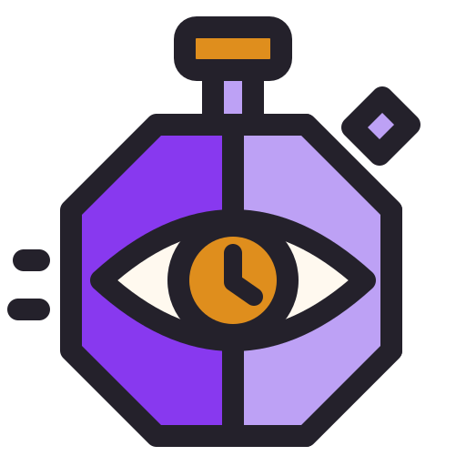
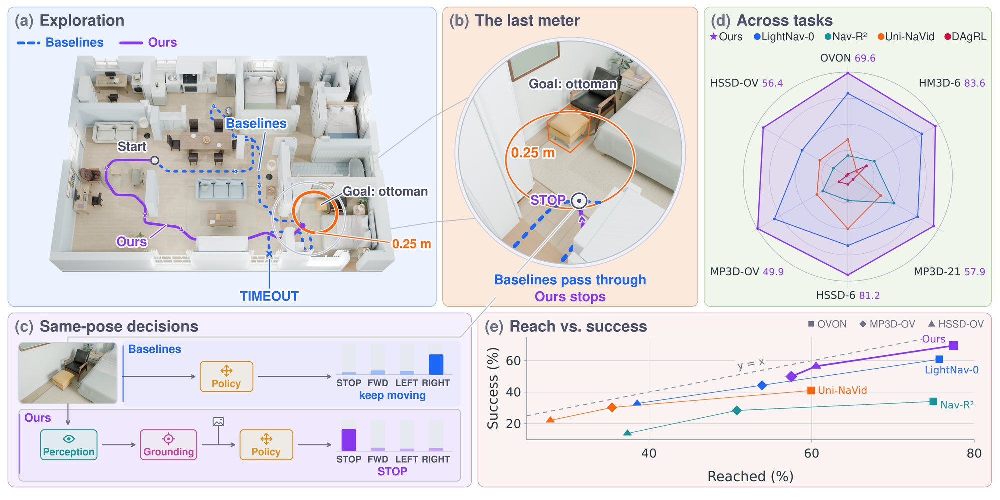

<div align="center">

<h1 align="center"> StopWatch:<br>Goal Grounding for Object-goal Navigation</h1>

[](https://arxiv.org/abs/2610.23841)
[](https://stopwatch-nav.github.io/)
[](https://huggingface.co/Amazon-FAR/stopwatch-perception-4b)
[](https://huggingface.co/Amazon-FAR/stopwatch-policy-2b)
[](https://huggingface.co/datasets/Amazon-FAR/stopwatch-data)

[Xinhao Liu](https://gaaaavin.github.io/),
[Yunsheng Tian](https://www.yunshengtian.com/)<sup>‡</sup>,
[Yuheng Qiu](https://haleqiu.github.io/),
[Pieter Abbeel](https://people.eecs.berkeley.edu/~pabbeel/)<sup>†</sup>,
[Xi Chen](https://www.linkedin.com/in/peter-xi-chen)<sup>†</sup>,
[Guanya Shi](https://www.gshi.me/)<sup>†</sup>,
[Chen Feng](https://engineering.nyu.edu/faculty/chen-feng)<sup>†</sup>

<sup>‡</sup> Project lead. <sup>†</sup> Equal advising.

</div>



## Getting Started

StopWatch has two models. The **perception** model is a 4B Qwen3-VL that predicts
goal grounding, the semantics in view and the distance to the goal. The **policy**
is a 2B Qwen3-VL that reads this grounding with RGB observations and selects STOP,
FORWARD, LEFT or RIGHT.

### 1. Environment

The codebase targets CUDA 13 and PyTorch 2.14.1.
[FlashAttention 4](https://github.com/Dao-AILab/flash-attention/tree/main/flash_attn/cute)
requires a Hopper or Blackwell GPU, such as H200 or B200.
Install [uv](https://docs.astral.sh/uv/getting-started/installation/), then clone
the repository and install the locked dependencies.

```bash
git clone https://github.com/amazon-far/stopwatch.git
cd stopwatch
uv sync --locked
bash scripts/install_habitat_sim.sh
source .venv/bin/activate
```

Use `uv sync --locked --inexact` for later syncs to keep the Habitat-sim wheel.

### 2. Run inference

Models load directly from Hugging Face. Download the evaluation data.

```bash
hf download Amazon-FAR/stopwatch-data --repo-type dataset \
  --include 'eval/*' --include 'vocab/*' --include 'protocol/*' --include README.md --local-dir data
```

Obtain scene assets from the publishers and place them under `data/scenes`.

| Benchmark | Scene assets and official downloads |
|---|---|
| OVON | [HM3D v0.2](https://github.com/matterport/habitat-matterport-3dresearch#-downloading-hm3d-v02), validation Habitat meshes in `hm3d-val-habitat-v0.2.tar` |
| MP3D-OV | [Matterport3D v1.0](https://niessner.github.io/Matterport/), the Habitat package `mp3d_habitat.zip` |
| HSSD-OV | [HSSD-200](https://3dlg-hcvc.github.io/hssd/), the static `scenes/` collection in [HSSD-Hab](https://huggingface.co/datasets/hssd/hssd-hab/tree/4369cb9876214c7fbebcf552eb532380e4d287e4), with stage and object configs, render and collision meshes, and the publisher scene dataset config |

```text
data/scenes/
|-- hm3d/val/<scene-directory>/
|   |-- <scene>.basis.glb
|   |-- <scene>.basis.navmesh
|-- mp3d/<scene>/
|   |-- <scene>.glb
|   |-- <scene>.house
|   |-- <scene>_semantic.ply
|   |-- <scene>.navmesh
|-- hssd-hab/
|   |-- hssd-hab.scene_dataset_config.json
|   |-- scenes/*.scene_instance.json
|   |-- stages/
|   |-- objects/
|   |-- semantics/
|   |-- metadata/
```

Start with ten episodes.

```bash
torchrun --standalone --nproc_per_node=1 -m stopwatch.evaluate \
  --config configs/eval_ovon_val_unseen.yaml --limit 10
```

Run the full benchmarks with the following commands. OVON val_unseen uses the
2,309-episode clean subset described in the paper.

| Benchmark | Episodes |
|---|---:|
| OVON val_unseen | 2,309 |
| MP3D-OV | 1,193 |
| HSSD-OV | 1,751 |

```bash
torchrun --standalone --nproc_per_node=1 -m stopwatch.evaluate \
  --config configs/eval_ovon_val_unseen.yaml
torchrun --standalone --nproc_per_node=1 -m stopwatch.evaluate \
  --config configs/eval_mp3dov.yaml
torchrun --standalone --nproc_per_node=1 -m stopwatch.evaluate \
  --config configs/eval_hssdov.yaml
```

### 3. Training

Both models train on OVON, MP3D and HSSD demonstrations. Follow
[the training guide](docs/training.md) to download trajectories, render RGB and
sparse semantic counts, train, resume and export weights.

```bash
torchrun --nnodes=8 --nproc_per_node=8 --node_rank="$NODE_RANK" --master_addr="$MASTER_ADDR" --master_port=29500 \
  -m stopwatch.train --config configs/train_perception_4b.yaml
torchrun --nnodes=2 --nproc_per_node=8 --node_rank="$NODE_RANK" --master_addr="$MASTER_ADDR" --master_port=29500 \
  -m stopwatch.train --config configs/train_policy_2b.yaml
```

## License

StopWatch code, models and data use the [Apache License 2.0](LICENSE).
Scene datasets retain their own terms. See [third-party notices](THIRD_PARTY_NOTICES).

## Citation

If you use StopWatch, please cite this paper.

```bibtex
@article{liu2026stopwatch,
  title={StopWatch: Goal Grounding for Object-goal Navigation},
  author={Liu, Xinhao and Tian, Yunsheng and Qiu, Yuheng and Abbeel, Pieter and Chen, Xi and Shi, Guanya and Feng, Chen},
  journal={arXiv preprint arXiv:2610.23841},
  year={2026}
}
```

## Acknowledgements

We build on [Habitat-sim](https://github.com/facebookresearch/habitat-sim),
[Habitat-Lab](https://github.com/facebookresearch/habitat-lab),
[HM3D-OVON](https://github.com/naokiyokoyama/ovon),
[Qwen3-VL](https://github.com/QwenLM/Qwen3-VL) and [verl](https://github.com/volcengine/verl).

## Relevant work

* [CityWalker: Learning Embodied Urban Navigation from Web-Scale Videos](https://ai4ce.github.io/CityWalker/)
* [Wanderland: Geometrically Grounded Simulation for Open-World Embodied AI](https://ai4ce.github.io/wanderland/)
* [GaussGym: An open-source real-to-sim framework for learning locomotion from pixels](https://arxiv.org/abs/2510.15352)
* [VLFM: Vision-Language Frontier Maps for Zero-Shot Semantic Navigation](https://arxiv.org/abs/2312.03275)
* [NaVid: Video-based VLM Plans the Next Step for Vision-and-Language Navigation](https://pku-epic.github.io/NaVid/)
* [Uni-NaVid: A Video-based Vision-Language-Action Model for Unifying Embodied Navigation Tasks](https://pku-epic.github.io/Uni-NaVid/)
* [Nav-R²: Dual-Relation Reasoning for Generalizable Open-Vocabulary Object-Goal Navigation](https://arxiv.org/abs/2512.02400)
* [LightNav-0: Eliciting VLM Spatial Intelligence for Generalist Embodied Navigation](https://arxiv.org/abs/2608.30935)
* [ABot-N0: Technical Report on the VLA Foundation Model for Versatile Embodied Navigation](https://arxiv.org/abs/2602.11598)
* [Qwen-RobotNav Technical Report: A Scalable Navigation Model Designed for an Agentic Navigation System](https://arxiv.org/abs/2606.18112)
* [Embodied Navigation Foundation Model](https://pku-epic.github.io/NavFoM-Web/)
* [OmniNav: A Unified Framework for Prospective Exploration and Visual-Language Navigation](https://arxiv.org/abs/2509.25687)

## Star history

<a href="https://star-history.com/#amazon-far/stopwatch&Date">
 <picture>
   <source media="(prefers-color-scheme: dark)" srcset="https://api.star-history.com/svg?repos=amazon-far/stopwatch&type=Date&theme=dark" />
   <source media="(prefers-color-scheme: light)" srcset="https://api.star-history.com/svg?repos=amazon-far/stopwatch&type=Date" />
   
 </picture>
</a>
